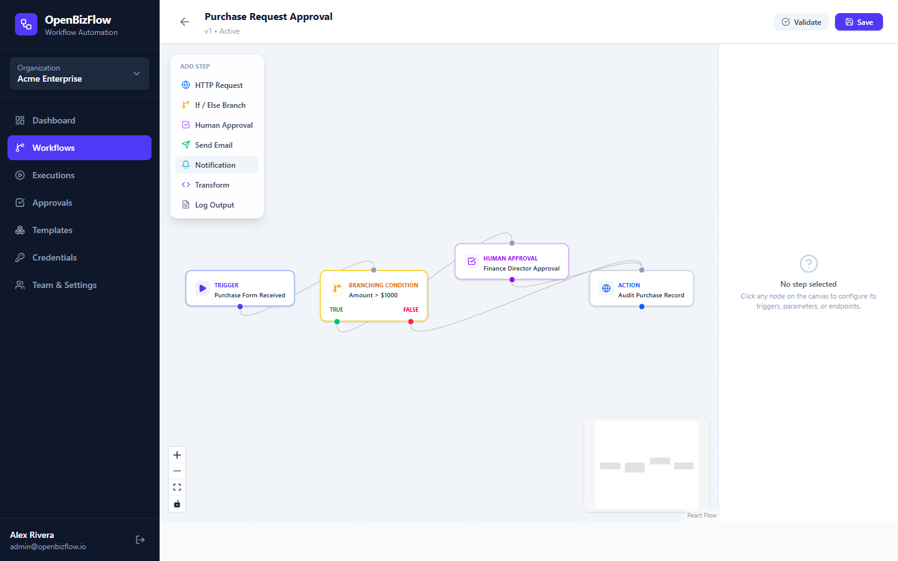
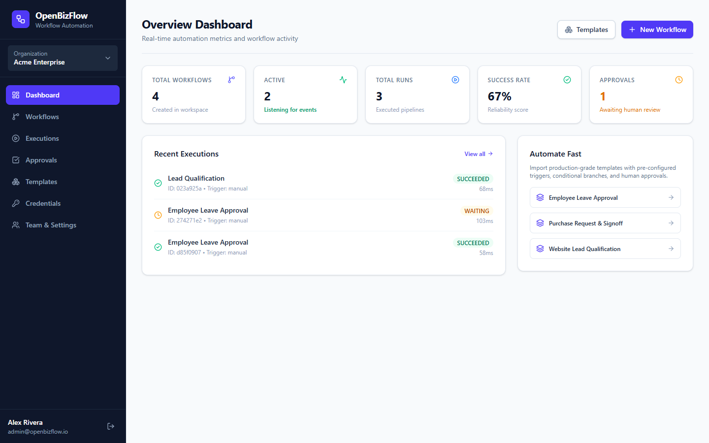
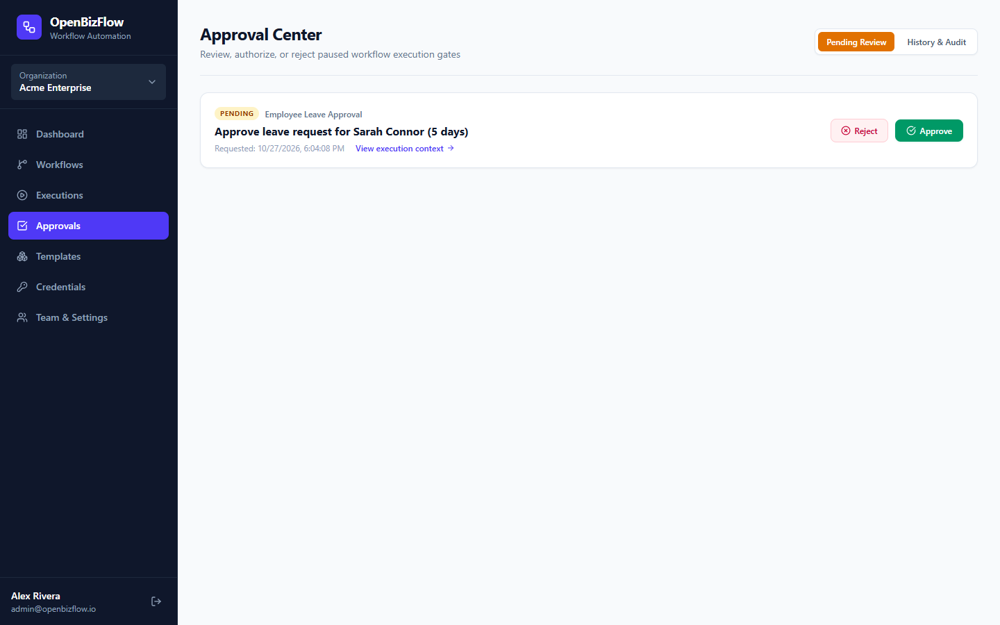
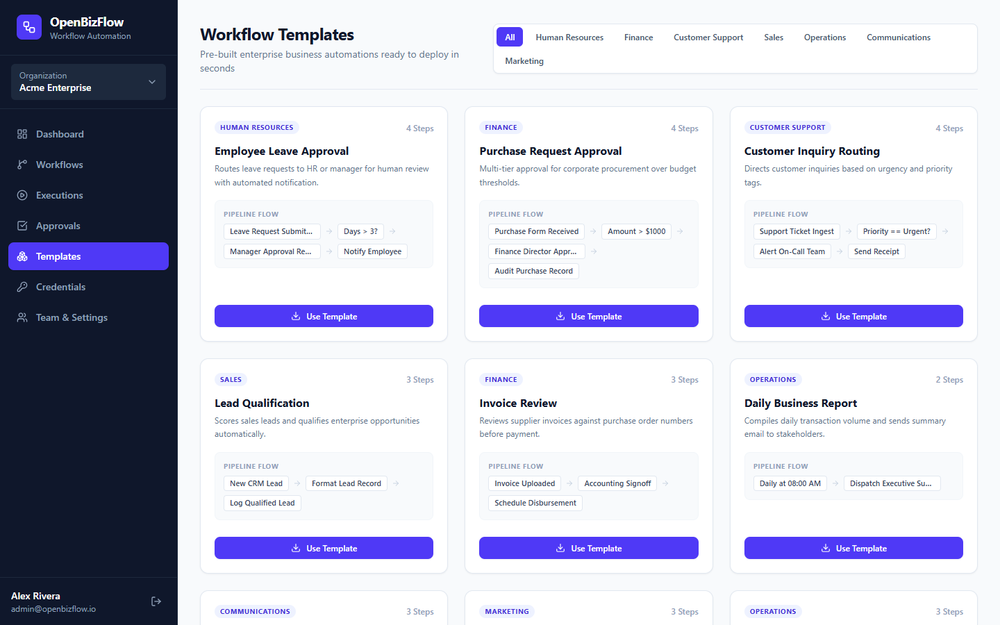
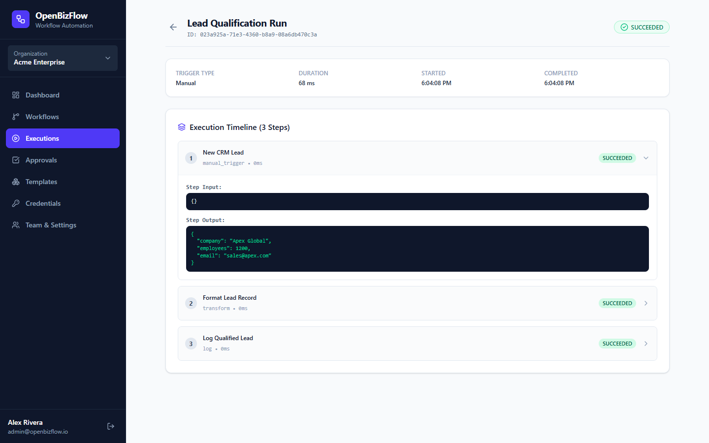

# OpenBizFlow — Open-Source Business Workflow Automation Platform

[](https://github.com/0xyz-exe/openbizflow/actions/workflows/ci.yml)
[](LICENSE)
[](https://python.org)
[](https://fastapi.tiangolo.com)
[](https://react.dev)
[](https://typescriptlang.org)

**OpenBizFlow** is a modern, self-hostable business process and workflow automation platform. Build visual DAG workflows, connect triggers and actions, orchestrate multi-branch conditions, enforce human approval gates, and monitor executions in real time.

---

## Screenshots & Platform Tour

### 1. Interactive Visual Workflow Builder
Drag-and-drop workflow canvas built with React Flow. Configure triggers, HTTP requests, if/else condition branches, and human approval checkpoints with live DAG validation.


### 2. Operational Overview Dashboard
Live metric aggregates, active listening workflows, execution throughput, success rate, and pending approval queues.


### 3. Human-in-the-Loop Approval Center
Review paused workflow executions, inspect payload context, and provide approval or rejection decisions with audit comments.


### 4. Enterprise Workflow Template Library
10 out-of-the-box business automations ready to deploy with one-click import.


### 5. Step-by-Step Execution Inspection
Detailed timeline showing status, duration in milliseconds, inputs, and outputs for every node in the pipeline.


---

## Key Features

- **Interactive Visual Editor**: Drag-and-drop workflow canvas built with React Flow, supporting custom node types, live graph validation, and parameter configuration.
- **Topological DAG Execution Engine**: Deterministic acyclic graph engine supporting linear chains, conditional branching (`true`/`false` paths), step output variable mapping, and audit logging.
- **Durable Human Approvals**: Stateful approval gates that safely pause execution in `WAITING` status and resume upon manager decision with complete audit notes.
- **Secure Webhook Ingestion**: Unique cryptographic endpoint tokens, optional HMAC-SHA256 signature verification, and deduplication via `X-Idempotency-Key`.
- **SSRF Egress Protection**: Outgoing HTTP request nodes prevent access to private IP ranges (`10.0.0.0/8`, `172.16.0.0/12`, `192.168.0.0/16`, `127.0.0.0/8`) and cloud metadata endpoints.
- **Encrypted Credential Vault**: Integration API keys, Bearer tokens, and passwords encrypted at rest using Fernet symmetric encryption and masked in all client responses.
- **Multi-Tenant Isolation**: Complete organization-level data segregation with role-based access control (`Owner`, `Admin`, `Editor`, `Operator`, `Viewer`).
- **10 Enterprise Templates**: Pre-built templates for Employee Leave, Purchase Requests, Lead Qualification, Support Ticket Routing, Invoice Verification, and more.

---

## Technology Stack

- **Backend**: Python, FastAPI, Pydantic, SQLAlchemy 2.0, Alembic, Bcrypt, Cryptography (Fernet), PyJWT, HTTPX
- **Frontend**: React 19, TypeScript, Vite, Tailwind CSS v4, `@xyflow/react` (React Flow), Lucide Icons
- **Database & Cache**: PostgreSQL 16, Redis 7 (SQLite local test mode supported)
- **Deployment**: Docker, Docker Compose, Nginx reverse proxy

---

## Architecture

```
+-----------------------------------------------------------+
|                   React 19 Visual Canvas                  |
|  - Drag & Drop Builder      - Real-Time Validation        |
|  - Step Inspector Panel     - Execution Monitor           |
+-----------------------------+-----------------------------+
                              | HTTPS / JSON
                              v
+-----------------------------------------------------------+
|                     FastAPI API Server                    |
|  - Auth & RBAC Middleware   - REST Routers (v1)           |
|  - Webhook Receiver         - Fernet Credential Vault     |
+-----------------------------+-----------------------------+
                              |
              +---------------+---------------+
              |                               |
              v                               v
+-----------------------------+ +---------------------------+
|    Workflow Engine (DAG)    | |  PostgreSQL / Redis Cache |
| - Kahn's Topological Traver | | - Multi-tenant Isolation  |
| - SSRF URL Guard            | | - Execution Audit Log     |
| - Human Approval Resumption | | - Idempotency Records     |
+-----------------------------+ +---------------------------+
```

---

## Quickstart with Docker Compose

1. Clone the repository:
   ```bash
   git clone https://github.com/0xyz-exe/openbizflow.git
   cd openbizflow
   ```

2. Copy the sample environment configuration:
   ```bash
   cp .env.example .env
   ```

3. Launch all services:
   ```bash
   docker compose up --build -d
   ```

4. Access the applications:
   - **Web UI**: [http://localhost:3000](http://localhost:3000)
   - **REST API Docs**: [http://localhost:8000/api/v1/docs](http://localhost:8000/api/v1/docs)

---

## Local Development

### 1. Backend Setup

```bash
cd apps/api
python -m venv .venv
source .venv/bin/activate  # Windows: .venv\Scripts\activate
pip install -r requirements.txt

# Run automated tests
pytest -v

# Start development server
uvicorn app.main:app --reload --port 8000
```

### 2. Frontend Setup

```bash
cd apps/web
npm install

# Run production build validation
npm run build

# Start frontend dev server
npm run dev
```

---

## Pre-Built Templates

OpenBizFlow includes 10 out-of-the-box workflow automations:

1. **Employee Leave Approval**: Multi-day leave verification and manager signoff gate.
2. **Purchase Request Approval**: Procurement request validation against budget thresholds.
3. **Customer Inquiry Routing**: Support ticket categorization and urgent notification dispatch.
4. **Lead Qualification**: Inbound CRM lead data cleansing and qualification scoring.
5. **Invoice Review**: Vendor invoice validation against purchase order records.
6. **Daily Business Report**: Scheduled KPI compilation and executive briefing.
7. **Scheduled Email Notification**: Automated weekly reminder notifications.
8. **Website Contact Form**: Inbound webhook processing with auto-responder.
9. **Inventory Threshold Notification**: Stock drop alerts with automatic reorder alerts.
10. **New Employee Onboarding**: IT equipment provisioning and welcome email delivery.

---

## Automated Verification

The test suite covers workflow validation, acyclic graph cycle detection, conditional branching, human approvals, HMAC webhooks, idempotency, SSRF protection, credential encryption, and multi-tenant isolation.

```bash
cd apps/api
pytest -v
```

Output:
```
tests/test_approvals.py::test_human_approval_lifecycle PASSED
tests/test_auth.py::test_register_and_login PASSED
tests/test_tenant_isolation.py::test_tenant_isolation_cross_access_denied PASSED
tests/test_webhooks.py::test_webhook_trigger_and_hmac_and_idempotency PASSED
tests/test_webhooks.py::test_credential_encryption_and_masking PASSED
tests/test_workflow_engine.py::test_dag_cycle_detection PASSED
tests/test_workflow_engine.py::test_ssrf_protection PASSED
tests/test_workflow_engine.py::test_linear_workflow_execution PASSED
tests/test_workflow_engine.py::test_conditional_branching_execution PASSED

======================= 9 passed in 6.40s =======================
```

---

## License

This project is licensed under the MIT License — see the [LICENSE](LICENSE) file for details.
